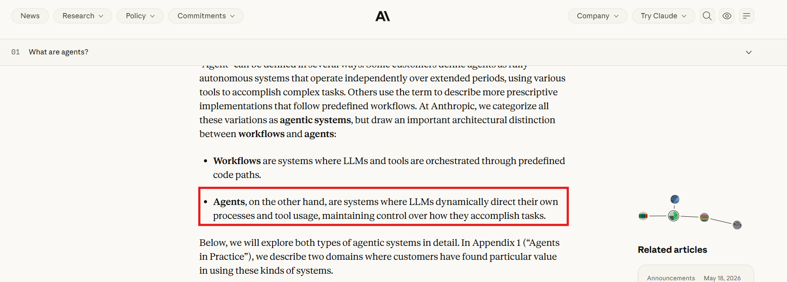

# Agent是什么?

不知道看完上面几个文章，大家是否能真的理解并且回答一个问题: Agent到底是什么？

现在的AI 产品的名字实在是太热闹了：Chatbot、Copilot、Workflow、Agent、AI Assistant、Computer Use……有时候一个聊天框也叫 Agent，有时候一个自动化流程里放了几个 LLM 节点，也叫 Agent。

我觉得问Agent是什么，不是一个单纯的命名问题。**如果 Agent 的边界不清楚，后面学 Agent 时，很容易把模型、工具、执行环境和产品 UI 混成一件事。**

## 1\. Agent 没有一个所有人都统一采用的定义

Anthropic 在 2024 年 12 月发布的 _Building effective agents_ 里，专门提到过这个问题：有些团队把 Agent 理解成可以长时间自主工作的系统；也有团队把按预设流程执行的 LLM 应用称为 Agent。



原文里有一句很清楚：

> “Workflows are systems where LLMs and tools are orchestrated through predefined code paths\.”

OpenAI 在 2026 年 1 月的 _A practical guide to building agents_ 里，给了一个偏产品和工程的说法：Agent 是能够代表用户独立完成任务的系统。它会用 LLM 管理工作流执行、做决策、选择工具，并能判断什么时候完成；失败时也应该能停下来，把控制权交还给用户。


两篇文章的措辞不同，重点却很接近：**Agent 的核心不是“用了大模型”，而是模型参与了任务执行过程中的决策。**

## 2 Agent 定义

**一个由模型参与运行时决策的执行系统。它接收目标和约束，获取当前上下文，按需选择工具或动作，根据真实执行结果调整下一步，直到任务完成、需要人介入，或触发系统边界。**

这里有几个关键词：

- **目标（Goal）**：用户希望完成什么，而不只是回答哪个问题。

- **运行时决策（Runtime Decision）**：下一步不是全部提前写死，模型可以根据新信息调整。

- **工具与环境（Tools / Environment）**：文件、浏览器、Shell、数据库、API 或领域工具。

- **观察结果（Observation）**：执行之后发生了什么，成功、失败、页面变化还是数据变化。

- **边界（Guardrails）**：模型能做什么、不能做什么，什么时候需要审批，什么时候必须停止。

这并不要求 Agent 必须 24 小时自主运行，也不要求一上来就做 Multi\-Agent。一个有明确工具、能自己决定下一步的单 Agent，就已经可以是 Agent。

## 3\. 真实产品的Agent结构

那为什么市面上的产品给大家一种感觉用了AI的应用都叫Agent呢?

这其实是真实产品通常是混合结构：

- 一条稳定、重复、需要审计的主流程交给 Workflow；

- 主流程里遇到不确定的异常，再交给 Agent 诊断；

- 涉及高风险写入、付款、删除或发布时，交给确定性代码和人工审批。

**Agent 不是 Workflow 的升级版。它是把一部分运行时决策交给模型的一种执行方式。**

## 4\. Agent和Loop绑定很深


Agent 其实也是模型操作的一个大循环：

```Plain Text
用户目标
   ↓
Harness 组装上下文和可用工具
   ↓
调用模型
   ↓
模型返回文本，或提出 Tool Call
   ↓
Harness 校验权限、参数和审批要求
   ↓
真正执行工具
   ↓
把工具结果作为 Observation 交回模型
   ↓
模型判断下一步，继续或结束
```

注意这件事：**模型提出调用请求，不代表工具已经执行。**

例如模型可能返回这样的结构化请求：

```JSON
{
  "tool": "run_quast",
  "arguments": {
    "assembly_path": "samples/S01.fasta"
  }
}
```

这只是一条调用意图。实际运行时，外部程序还要检查工具是否存在、参数是否有效、当前用户是否有权限、是否需要人工批准，然后才调用 `run_quast`。工具执行完毕，再把结果返回给模型。

模型负责判断“下一步想做什么”；执行系统负责判断“这一步是否允许，以及如何真正执行”。

## 参考资料：原始文章

**\[1\] Anthropic — Building effective agents（2024\-12\-19）**

https://www\.anthropic\.com/research/building\-effective\-agents

重点阅读：\*What are agents?\*、\*When \(and when not\) to use agents\*、\*Building blocks, workflows, and agents\*。这篇文章适合建立 Workflow 与 Agent 的架构区别。Anthropic 也在页面上提醒：2024 年文章中的工具生态已经变化，当前产品形态需要结合后续 Managed Agents 文档理解。

**\[2\] OpenAI — A practical guide to building agents（2026\-01\-15）**

https://openai\.com/business/guides\-and\-resources/a\-practical\-guide\-to\-building\-agents/

重点阅读：\*What is an agent?\*、\*Agent design foundations\*、\*Orchestration\*、\*Guardrails\*。它更偏产品和工程实践，明确讨论工具选择、执行循环、handoff 和人工介入。

**\[3\] OpenAI Developers — Building agents**

https://developers\.openai\.com/tracks/building\-agents

重点阅读：Agent、Handoff、Guardrail、Session 等基础概念，以及 Agents SDK 如何处理 Agent Loop 和 Trace。
