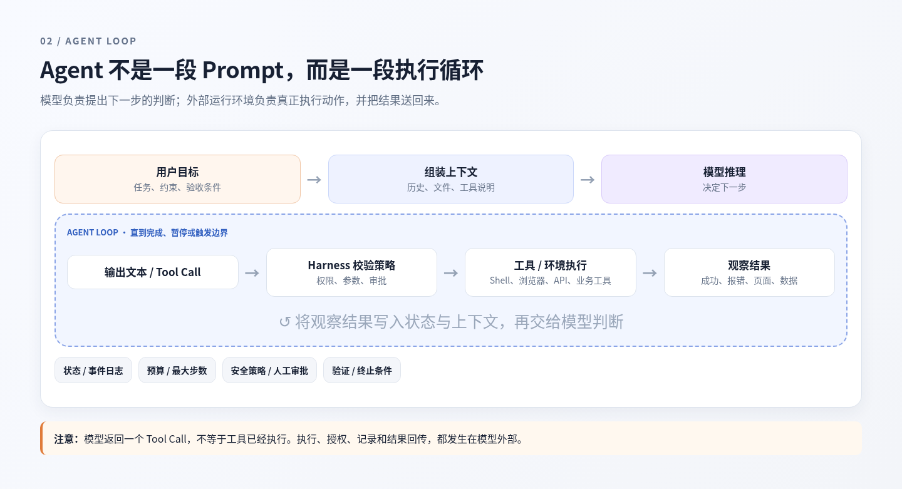
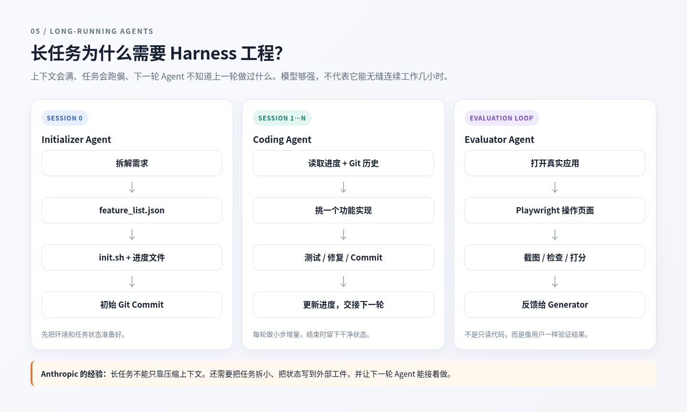
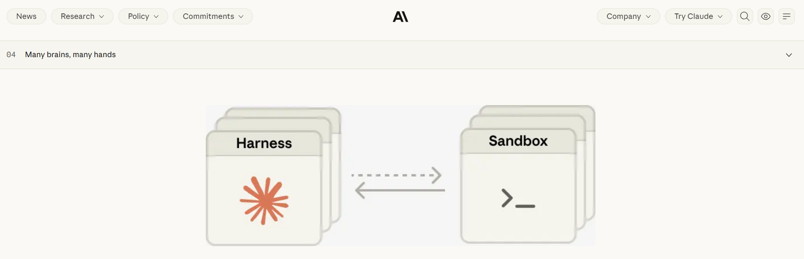

# Harness的定义


# 面试官: 请用一句话描述什么是 Harness?


> 模型决定 Agent 能力的上限，Harness 决定这些能力能不能落到真实任务里。这篇把它拆开看看里面到底有什么。
> 
> 


## 0️⃣ 前言


上一篇把 Agent 说到"由模型参与运行时决策的执行系统"，这一篇往下问一层：那个执行系统具体是些什么。


同一个模型，放在普通聊天框里主要是回答问题，放进 Claude Code、Codex 这类产品里，却能读代码、改文件、跑测试、修报错，甚至连着干几个小时。


模型变强当然是一部分原因，但只看模型，解释不了这个差距。


模型外面还有一整套东西：上下文怎么组织、工具怎么接、命令在哪跑、权限怎么卡、任务怎么续、失败怎么恢复、结果怎么验证。


这套东西就是 **Agent Harness**。


## 1\. 🧩 Agent = Model \+ Harness


LangChain 在 2026 年 3 月的 [*The Anatomy of an Agent Harness*](https://www.langchain.com/blog/the-anatomy-of-an-agent-harness) 里用一个开篇: "Can someone please define a harness?"： 然后回答到:

```Plain Text
Agent = Model + Harness
If you're not the model, you're the harness.
```


图1: [*The Anatomy of an Agent Harness*](https://www.langchain.com/blog/the-anatomy-of-an-agent-harness) 文章截图


按这篇的说法，Harness 是模型之外的代码、配置和执行逻辑。原始模型本身不是 Agent，等系统把状态、工具执行、反馈回路和可执行的约束都给它了，模型才算成了一个能干活的东西。\[参考1\]


Anthropic 在 2026 年 4 月的 *Scaling Managed Agents: Decoupling the brain from the hands* 里就划得细得多：Harness 是调用 Claude、并把工具调用路由到相应基础设施的那个循环。它把 Agent 拆成三块能独立替换的部分\[参考2\]：

- **Session**：记录整个过程的只追加事件日志。

- **Harness**：调用模型、路由工具调用的循环。

- **Sandbox**：模型运行代码、编辑文件的执行环境。


图2:[ Scaling Managed Agents](https://www.anthropic.com/research/managed-agents) 文章截图

说白了就是一个句话:  **Agent里除了模型以外都是harness，harness是负责Agent执行的管家**\.

如果是等式换算

```Plain Text
Agent = Model + Harness
Harness = Tool + Context + anycontrol(MCP, Safety...)
```


## 2\. 🔍 Harness 到底管什么


我觉得最好记的拆法还是三层：


- 🔵 **知道什么（Context）**：模型当前能看到哪些信息？

- 🟢 **能做什么（Capability）**：它能通过哪些工具和环境动手？

- 🟣 **怎么管住（Control）**：谁来执行、谁来批、怎么停、挂了怎么恢复？

    

### 2\.1 🔵 知道什么：Context Engineering


模型不会自动知道你的项目结构、业务规则、文件内容和团队约定。Harness 要负责把这些组织起来，在合适的时候放进上下文。


常见的是这几样：

|组件|解决什么|常见形式|
|---|---|---|
|System Prompt|Agent 的角色、目标和基本约束|系统提示词|
|项目说明 / 记忆|项目目录、构建方式、架构约定|`AGENTS.md`、`CLAUDE.md`|
|检索与文件读取|需要时查找外部知识|RAG、文件工具、代码搜索|
|Skill|某类任务的操作方法和领域知识|`SKILL.md`、references、scripts|
|历史管理|控制上下文长度，保留重要状态|截断、摘要、compaction、context reset|


OpenAI 在 *Harness engineering* 里提到，他们给 Codex 用的 `AGENTS.md` 大概只有 100 行，主要当一张地图用，指向更完整的架构文档、设计说明和执行计划，不是把所有知识塞进一个超长 Prompt。\[参考3\]


图3: [OpenAI Harness engineering](https://openai.com/index/harness-engineering/) 原文截图

这里大概也表明了，在Agent体系中，习惯用这种渐进式的方法，给模型知识。就跟看书先翻目录一样，Agent 能看的字变多了，不等于该把整个库一次性喂进去，它得知道东西放在哪、什么时候该去翻。


### 2\.2 🟢 能做什么：Tool、MCP 和执行环境


模型不能直接读你电脑上的文件，也不能凭空跑命令、开浏览器、改数据库。它得有工具接口。

|组件|它负责什么|可以怎么理解|
|---|---|---|
|Tool / Function|暴露一个可执行动作和参数 Schema|Agent 的"手"|
|MCP|标准化工具和数据的接入方式|连接外部系统的"插座"|
|Execution Environment|真正跑命令、代码、浏览器操作的地方|工作台 / 车间|
|Subagent|把子任务交给另一个独立上下文|另一个同事 / 分身|


Tool 的定义一般包含名称、描述和参数 Schema，模型生成的调用请求长这样：


```JSON
{
  "type": "tool_use",
  "id": "call_1",
  "name": "update_components",
  "input": {
    "updates": [
      { "name": "Button_1", "set": { "text": "Start" } }
    ]
  }
}
```


这只是个请求。真正去执行 `update_components` 的，是 Harness 调度的工具实现。


MCP 也不是什么新的 Agent 能力。它解决的是外部工具和数据怎么用统一的方式接进来。通过 MCP 接进来的工具，一样要过权限、参数校验、执行环境和结果回传。


### 2\.3 🟣 怎么管住：Control Plane


模型能决定下一步，不等于它可以随便动。Harness 还得管住执行的边界：


- **Loop 控制**：最多跑几步？重复调用怎么处理？什么时候算结束？

- **权限与审批**：只读、要批、自动批，各能做什么？

- **Sandbox**：工具执行时能碰哪些文件、网络和系统资源？

- **Hooks / Middleware**：工具调用前后、会话开始或收尾前，强制执行哪些规则？

- **State / Checkpoint**：中途挂了从哪恢复？

- **Verification**：结果到底过没过测试、编译、渲染或业务校验？

- **Trace / Evals**：每一步干了什么？改完之后性能有没有退步？

    

经常用大语言模型的小伙伴就知道：这些约束规则不能是**只写在 Prompt 里，Prompt的始终是软约束，这些执行边界的事情必须是被应用强约束住，**比如"不要删除生产数据"，写进 Prompt 可以，但真正卡住的得是工具层和权限系统。Prompt 是模型要遵守的指令，权限检查是系统实际执行的边界。


## 3\. 🔨 一个最小 Harness 大概长什么样




图 4:  一次 Agent Run 中的模型调用、工具执行和状态记录


缩到最小实现，大概是这样：

```Python
messages = [system_prompt, user_request]
step = 0

while step < MAX_STEPS:
    # ① 模型只负责推理，并返回文本或工具调用请求
    response = model.generate(messages, tools=TOOLS)

    if not response.tool_calls:
        return response.text

    # ② Harness 接管工具调用
    for call in response.tool_calls:
        if not policy.allows(call):
            result = "TOOL_PERMISSION_DENIED"
        elif needs_approval(call) and not user_approves(call):
            return "stopped by user"
        else:
            result = tools.execute(call.name, call.arguments)

        # ③ 记录执行事件，把真实结果交回模型
        event_log.append({"call": call, "result": result})
        messages.append(tool_result(call.id, result))

    step += 1

return "Reached runtime limit; task not marked as complete."
```


这段是概念示意，想体现的意思就是里面只有 `model.generate()` 属于模型调用，上下文组装、循环、权限判断、人工审批、工具执行、日志和终止条件，全在模型外面。


Harness 工程的工作量主要就压在这部分。


## 4\. 🧭 Runtime、Framework、Harness、Product 不是一个事


下面是我为了学习方便做的划分，不是所有框架都严格这么叫。


|名词|主要负责什么|例子 / 直觉|
|---|---|---|
|**Model**|理解输入、推理、生成下一步|GPT、Claude、DeepSeek|
|**Framework / SDK**|提供构建 Agent 的抽象和 API|OpenAI Agents SDK、Claude Agent SDK、LangChain|
|**Runtime**|把一次任务跑起来：模型调用、工具调度、事件、状态、取消、恢复|Agent Loop、Session 管理、持久化执行|
|**Harness**|模型工作的整套配置与运行环境：上下文、工具、运行逻辑、权限、反馈和约束|LangChain 文章里的 Agent Harness|
|**Product**|用户实际使用的入口和体验|Claude Code、Codex App、Cursor 等|


打个比方，Runtime 是发动机和传动系统，Harness 是整套让模型干活的装备和制度，Product 是坐进去操作的驾驶舱。


实际产品里这些边界经常是合在一起的。一个 Coding Agent 可能把 CLI、Runtime、工具、上下文和权限打包交付，一个托管 Agent 服务则可能把 Session、Harness、Sandbox 拆成独立服务。


## 5\. 🚀 为什么 Harness 最近这么火


### 5\.1 模型能做的事变多了，短板开始露出来


推理能力上来以后，很多任务卡的不再是"它不知道怎么写"，而是：


- 它不知道项目里有哪些约定

- 它拿不到该用的文件或工具

- 它执行完没验证

- 它跑太久，上下文满了

- 它下一轮忘了上一轮干过什么

- 它出错后恢复不了，或者误以为任务已经完成

    

这类问题换一个更大的模型解决不了，得在模型外面补环境、补状态、补反馈。


### 5\.2 Agent 从几轮交互，走到小时级甚至跨会话


Anthropic 在 2025 年 11 月的 *Effective harnesses for long\-running agents* 里聊了个很具体的问题：一个复杂任务经常超出单个 Context Window，下一轮 Agent 启动时并不自动拥有上一轮的完整记忆。


图5: [*Effective harnesses for long\-running agents*](https://www.anthropic.com/research/effective-harnesses-for-long-running-agents)* *文章截图

他们发现单靠 compaction（压缩历史）不够。模型可能一次做太多，中途把上下文耗光，也可能看到项目已经有点进展，就以为任务做完了。

他们的做法是两段式：

1. **Initializer Agent**：第一次运行时把环境搭好，建 `init.sh`、`claude-progress.txt` 和初始 Git Commit，还会把用户一句话的需求拆成更完整的功能清单。在 Claude\.ai clone 那个例子里，清单超过 200 项，初始状态全部标为未通过。

2. **Coding Agent**：之后每一轮只做一个功能，测试、提交、更新进度文件。新一轮 Agent 靠进度文件和 Git 历史知道当前到哪了。\[参考4\]




图 6: Anthropic 长任务 Harness：初始化、增量开发和验证


这已经不是多塞几条 Prompt 的事了。任务拆分、外部状态、跨会话交接、可恢复的执行环境，都得有。


### 5\.3 真实反馈比模型自己觉得做完更重要


Anthropic 在 2026 年 3 月的 *Harness design for long\-running application development* 里又往前推了一步：Planner、Generator、Evaluator，三个 Agent 分工。


图7: [*Harness design for long\-running application development *](https://www.anthropic.com/research/harness-design-long-running-apps)文章截图

Evaluator 不只是读 Generator 写出来的代码，它拿 Playwright 去操作正在跑的应用，按测试标准看行为、截图、记问题，再把反馈交回去让 Generator 修。\[参考5\]


原文给了个很直观的对比：

|方案|时间|成本|
|---|---|---|
|Solo Agent|20 分钟|$9|
|完整 Harness|6 小时|$200|


成本超过 20 倍，产出质量差得也挺明显。这个例子不是说要所有任务都上三个 Agent，它说的是：任务要跑很久、交付复杂、还要真实验证的时候，多花的 Harness 成本大概是值的。\[5\]


### 5\.4 OpenAI 的 Harness Engineering


OpenAI 在 2026 年 2 月的 *Harness engineering: leveraging Codex in an agent\-first world* 里记了个内部实验：团队用 Codex 把一个产品从建到交，代码、测试、CI 配置、文档、可观测性和内部工具都由 Codex 生成。

五个月后代码库大概 100 万行，累计合了约 1,500 个 PR，最开始只有 3 名工程师驱动。团队估整个项目花的时间大约是手写的十分之一。\[参考3\]


图8: [OpenAI Harness engineering](https://openai.com/index/harness-engineering/) 原文截图

文中有一句话挺能概括这种方式：

> "Humans steer\. Agents execute\."
> 
> 

工程师的重心也变了。不只是写代码，还得设计环境、表达意图、组织知识、搭反馈回路，把架构约束变成能自动检查的规则。


OpenAI 的具体做法是：


- 把项目知识整理进仓库，用短短的 `AGENTS.md` 当入口地图

- 把复杂任务的执行计划、进度和决策记成版本化文件

- 用自定义 Lint、结构测试和 CI 硬卡架构

- 把错误反馈转成文档或工具规则，让之后的 Agent 也用得上\[3\]

    

写了多少行代码不是重点。重点是它展示了一个团队怎么把原本靠资深工程师经验的事，一点点编成 Agent 看得懂、查得出的环境。


## 6\. 📦 Session、Harness、Sandbox 其实可以拆开的


Anthropic 在 2026 年 4 月的 *Scaling Managed Agents* 里，把前面这些工程问题抽象成了三个独立接口：

差不多就是: Agent = Model \+ Harness \+ Session \+ Sandbox\.\.\.\.\.


图9:[ Scaling Managed Agents](https://www.anthropic.com/research/managed-agents) 文章截图



图10:[ Scaling Managed Agents](https://www.anthropic.com/research/managed-agents) 文章截图


- **Session** 是持久化的事件日志，不等于模型当前的 Context Window

- **Harness** 负责调用模型、路由工具调用，把事件写进 Session

- **Sandbox** 是实际跑代码、改文件的环境

    

拆开是因为它们应该能各自独立失败、独立替换。


比如 Sandbox 挂了，Harness 可以把错误当成一次工具执行失败交给模型，必要时重建环境。Harness 自己挂了，也能从持久化的 Session 日志恢复，不用要求原来那个进程一直活着。\[参考2\]


Anthropic 还提了个挺有意思的现象：**Harness 里的机制会随着模型变强而过时**。之前给 Claude Sonnet 4\.5 加的 Context Reset，到 Claude Opus 4\.5 上已经多余了。\[参考2\]


所以 Harness 不是越复杂越好，它该补的是模型当前的短板，别把所有历史补丁一直留着。


## 📖 参考


**\[1\] LangChain — The Anatomy of an Agent Harness（2026\-03\-10）**

https://www\.langchain\.com/blog/the\-anatomy\-of\-an\-agent\-harness

`Agent = Model + Harness` 那个公式、Harness 的组成清单，还有"模型本身不能持久化状态、执行代码或访问实时知识"的论述，都出自这篇。


**\[2\] Anthropic — Scaling Managed Agents: Decoupling the brain from the hands（2026\-04\-08）**

https://www\.anthropic\.com/research/managed\-agents

看 Session、Harness、Sandbox 怎么拆，Brain 和 Hands 怎么解耦，以及事件日志和故障恢复。


**\[3\] OpenAI — Harness engineering: leveraging Codex in an agent\-first world（2026\-02\-11）**

https://openai\.com/index/harness\-engineering/

看 Agent\-first 下工程师的角色、仓库知识、`AGENTS.md`、执行计划、Lint、结构测试和反馈闭环。


**\[4\] Anthropic — Effective harnesses for long\-running agents（2025\-11\-26）**

https://www\.anthropic\.com/research/effective\-harnesses\-for\-long\-running\-agents

看 Initializer Agent、Coding Agent、Feature List 和跨 Context Window 的状态交接。


**\[5\] Anthropic — Harness design for long\-running application development（2026\-03\-24）**

https://www\.anthropic\.com/research/harness\-design\-long\-running\-apps

看 Planner / Generator / Evaluator、Playwright 实测、反馈迭代，还有 Solo 和 Full Harness 那次成本对比。


**补充：OpenAI — A practical guide to building agents（2026\-01\-15）**

https://openai\.com/business/guides\-and\-resources/a\-practical\-guide\-to\-building\-agents/

从模型、工具、指令、编排和 Guardrails 几个角度理解工程基础。

