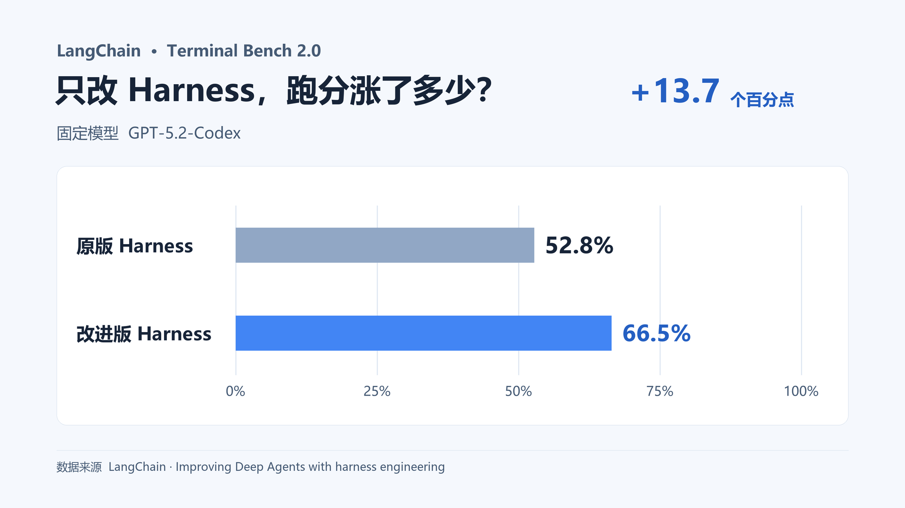
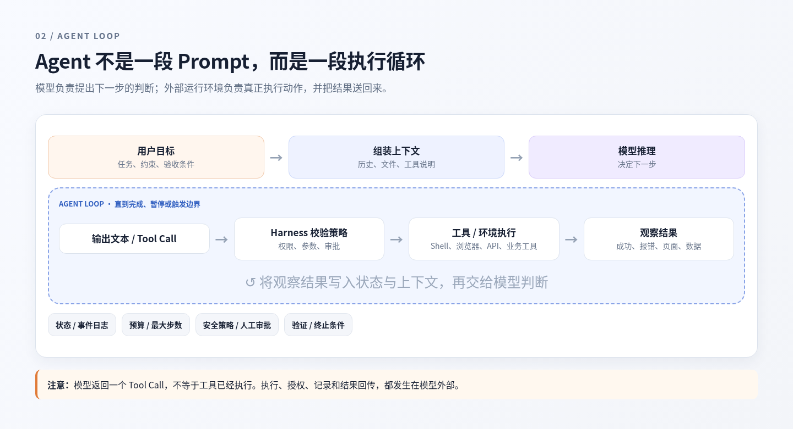
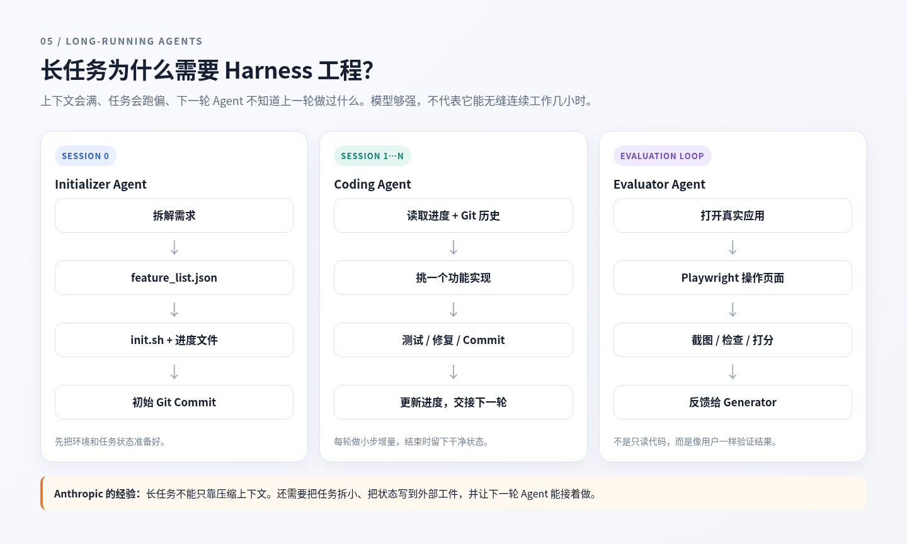
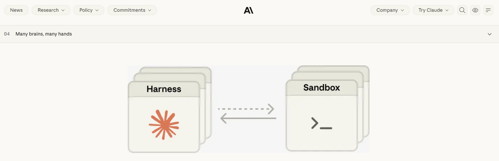

# 什么是 Agent Harness？

16∶9 横屏，中文讲解字幕，预计 4 分 38 秒。以《Harness的定义》里的原文截图和配图为主，口播跟着图中的定义、流程和架构走。开场数据图来自 LangChain 的实验。

## 开场与定义

### S01 · LangChain 的跑分实验

00:00–00:24 · 24 秒

**口播**

大家好。LangChain 拿自家的编程 Agent 跑了同一套测试。前后用的是同一个模型，只改了 Harness。成绩从 52.8% 涨到 66.5%，多了 13.7 个百分点。这个 Harness 到底管什么？

**画面与调度**

同用 GPT-5.2-Codex，两根横条依次长到 52.8% 和 66.5%，最后出现差值。 [LangChain 的实验原文](https://www.langchain.com/blog/improving-deep-agents-with-harness-engineering)

### S02 · Agent = Model + Harness

00:24–00:50 · 26 秒

**口播**

其中一项改动，是在 Agent 准备退出时，提醒它照着任务要求再验一遍。看 LangChain 原文红框里的等式，Agent 等于模型加 Harness。这里说的 Harness，包括模型外面的程序、配置和运行规则。

**画面与调度**

先点出退出前验证是其中一项改动。展示文章图 1，随后放大红框，同时在旁边保留等式和中文定义。 [LangChain 的定义与公式](https://www.langchain.com/blog/the-anatomy-of-an-agent-harness)

## Harness 到底管什么

### S03 · 上下文怎么进模型

00:50–01:10 · 20 秒

**口播**

第一件事是上下文。OpenAI 这张图里，给 Codex 用的 AGENTS.md 只有百来行，相当于仓库的目录。它指向架构文档和执行计划。Agent 要用哪部分资料，再沿着目录去读。

**画面与调度**

把图 3 放大到标记过的两段，依次指出「目录」「约一百行」「指向仓库文档」。 [OpenAI 对仓库知识的组织方式](https://openai.com/index/harness-engineering/)

### S04 · 工具怎么被调用

01:10–01:30 · 20 秒

**口播**

第二件事是工具。Harness 先把可用的工具和参数格式告诉模型。模型给出工具名和参数，Harness 找到对应的工具，在执行环境里运行，再把结果带回来。MCP 管的是外部工具和数据怎么接进来。

**画面与调度**

沿图 4 的工具执行一段走。旁边用「工具名与参数 → 调度 → 执行环境」标清职责，最后补上 MCP 的接入位置。

### S05 · 权限和执行边界

01:30–01:50 · 20 秒

**口播**

第三件事是权限。提示词把规则告诉模型，真正的检查发生在执行之前。Harness 判定请求要拒绝、等审批，还是可以放行。工具跑起来以后，沙箱再限制它能访问的文件、网络和其他资源。

**画面与调度**

镜头留在图 4，放大「Harness 检查策略」。依次亮出权限检查、人工审批和沙箱限制。

### S06 · 一个 Agent 执行循环

01:50–02:15 · 25 秒

**口播**

把镜头拉回来，这就是一次 Agent 执行循环。先拼出这一轮的上下文，再调用模型。拿到工具请求就检查、执行。结果一份记进日志，一份放回上下文，交给模型决定下一步。模型给出最终答复，或者运行到步数上限，循环就停。

**画面与调度**

先看文章图 4 全图，镜头依次靠近上下文与模型、工具调用与反馈。画面下方补充「返回最终答复」和「达到步数上限」两个出口。

### S07 · 运行时、框架和产品

02:15–02:36 · 21 秒

**口播**

文档里提到的运行时，负责让任务跑起来，刚才那个循环就在里面。框架或者 SDK 提供搭建 Agent 的接口。我们打开的应用是产品。按 LangChain 的叫法，运行时连同工具、上下文和权限，都算在 Harness 里。

**画面与调度**

保留图 4 的执行循环，先标出运行时，再加上框架和产品的职责，最后圈出广义 Harness 的范围。

## 长任务与反馈

### S08 · 换了上下文，任务怎么接上

02:36–03:00 · 24 秒

**口播**

长任务经常跑过一个上下文窗口。Anthropic 把交接做进了流程。第一次会话搭环境，留下功能清单和初始提交。之后每轮先读进度文件和 Git 历史，做完一项就测试、提交，更新进度。换一轮，任务还能接着跑。

**画面与调度**

先用图 5 点出长任务问题，再推到图 6 左、中两列，沿着「初始化 → 增量开发」看交接时会留下什么。 [Anthropic 的长任务实验](https://www.anthropic.com/research/effective-harnesses-for-long-running-agents)

### S09 · 用实际运行结果验收

03:00–03:22 · 22 秒

**口播**

Anthropic 后来把验收也单独拉了出来。Planner 拆需求，Generator 做实现，Evaluator 按标准验收。验收 Agent 会用 Playwright 操作正在跑的应用，把看到的问题记下来，再交回给负责实现的 Agent。

**画面与调度**

图 7 交代文章出处。切到图 6 右侧的验收栏，依次放大启动应用、操作页面、记录问题和回传反馈。 [Anthropic 的验收方法](https://www.anthropic.com/research/harness-design-long-running-apps)

### S10 · 把架构约定变成检查

03:22–03:42 · 20 秒

**口播**

OpenAI 这张图里写的是，人来掌舵，Agent 去执行。这里的掌舵也包括设计工作环境。团队把架构约定写进 Lint 和结构测试。检查失败时，把哪里出错、该怎么修，直接反馈给 Codex。

**画面与调度**

放大图 8 的红框。沿原文旁边依次注出「架构约定」「自动检查」「反馈给 Codex」。 [OpenAI 的架构规则与修复提示](https://openai.com/index/harness-engineering/#enforcing-architecture-and-taste)

## 托管 Agent 的拆分

### S11 · Session、Harness 和 Sandbox

03:42–04:14 · 32 秒

**口播**

到 Anthropic 的托管服务，Harness 专指中间调模型、分派工具的循环。左边的 Session 保留事件日志，右边的 Sandbox 跑代码、改文件。需要看之前的记录时，Harness 通过 getEvents 取一段日志，放进当前上下文。拆开以后，沙箱可以独立重建，Harness 中断也能读原来的日志恢复。

**画面与调度**

依次放大图 2 的部件关系、图 9 的请求和事件返回箭头、图 10 的 Harness 与 Sandbox 独立部署。 [Anthropic 的托管架构与恢复机制](https://www.anthropic.com/research/managed-agents)

### S12 · Harness 会跟着模型变

04:14–04:38 · 24 秒

**口播**

Anthropic 还发现，Sonnet 4.5 快用满上下文时，容易提前收工。他们让它留下进度，换一轮接着干。换到 Opus 4.5，这个问题没有再出现，重置那一步也就用不上了。

好，这期就聊到这儿。谢谢大家。

**画面与调度**

用两行标出文章记录的模型差异，随后切到「谢谢大家」。 [Anthropic 对上下文重置的观察](https://www.anthropic.com/research/managed-agents)
